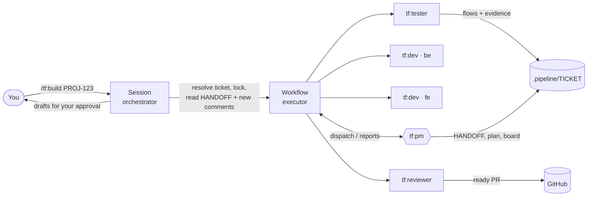

<div align="center">

# tf — task-flow

**A PM-led agent team for Claude Code: plan the ticket, build it, test it end to end, ship a ready PR.**

[](CHANGELOG.md)
[](LICENSE)
[](https://code.claude.com/docs/en/plugins/install.md)

`/tf:build` · `/tf:qc` · `/tf:feedback` · `/tf:review` · `/tf:e2e`

</div>

---

## Why tf

Running a ticket through one long agent session is slow and hard to trust: the same agent writes and judges
the code, tests are re-driven by hand every round, and a QC report three days later means re-reading
everything. **tf** organises the work like a small team:

- **A PM agent decides.** It reads the ticket, writes a micro-task plan, sizes the task, and chooses which
  agents run, in what order, on which model. Small tasks get one dev and one tester; big ones get parallel
  devs per repo and a stricter review.
- **Hard rules live in code, not prompts.** No PR before the tester passes the latest code. No PR before a
  review gate. Writer ≠ judge. PRs are always ready. Caps stop loops that do not converge.
- **E2E flows are kept.** Every case becomes a re-runnable script. A QC round re-runs the flows in minutes
  instead of clicking through the UI again.
- **One card per ticket.** `HANDOFF.md` (≤ 80 lines) is all a later round needs to start, even days later.
- **One folder per ticket.** `.pipeline/<TICKET>/` and `.worktrees/<TICKET>/<repo>/` are reused across
  every mode and round — no `-e2e`, `-fix`, `-r2` copies.

## Contents

- [Quick start](#quick-start)
- [Commands](#commands)
- [Attaching artifacts and design systems](#attaching-artifacts-and-design-systems)
- [How it works](#how-it-works)
- [Workspace configuration](#workspace-configuration)
- [Files tf creates](#files-tf-creates)
- [E2E flows](#e2e-flows)
- [Requirements](#requirements)
- [Troubleshooting](#troubleshooting)
- [FAQ](#faq)

## Quick start

```
/plugin marketplace add sdc-ren/sdc-claude
/plugin install tf@sdc
```

Then, in your workspace (the folder that holds your repos):

```
/tf:status --doctor   # checks tools, gh login, config, repos, Playwright, devices
/tf:build PROJ-123    # first run offers to create .claude/task-flow.md if it is missing
```

## Commands

Seven commands. The five task commands take a **ticket key** (`PROJ-123`), a **PR URL**
(`https://github.com/org/repo/pull/12`) or, for `build`, plain text. Everything after the input is optional.

| Command | Use it to |
|---|---|
| [`/tf:build`](#tfbuild) | Do a new task end to end |
| [`/tf:qc`](#tfqc) | Answer a QC report on a task tf already did |
| [`/tf:feedback`](#tffeedback) | Check and answer the team's review on the PRs tf pushed |
| [`/tf:review`](#tfreview) | Review a teammate's PR (e2e + risk report, no code changes) |
| [`/tf:e2e`](#tfe2e) | Run e2e only, or the regression suite |
| [`/tf:status`](#tfstatus) | See what tasks hold; check the machine |
| [`/tf:clean`](#tfclean) | Free a task, migrate old layouts |

### Options shared by the task commands

| Option | Works with | Effect |
|---|---|---|
| `--attach` | build · qc · review · e2e | Before the PM starts, show a checkbox list of this workspace's artifacts and design systems; ticked items are read into `specs/` and used by the PM, devs and testers |
| `--lang <code>` | build · qc · feedback · review · e2e | Report language for this run (`vi`, `en`, …); overrides the workspace config |
| `--approve` | build · qc | Stop after the PM writes the plan and wait for your approval |
| `--check` | feedback | Only fetch and triage the review points — no code, nothing posted |
| `--draft` | build · qc | Allow a draft PR. Without it every PR is opened ready, and agents never choose draft |
| pasted `https://claude.ai/artifact/…` | build · qc · review · e2e | Attach that artifact directly (same as ticking it) |

You can also pick artifacts with the **Artifacts (n)** band above the chat input before sending the command
(see [Attaching artifacts](#attaching-artifacts-and-design-systems)).

### `/tf:build`

```
/tf:build <ticket | text> [--attach] [--approve] [--draft] [--lang <code>]
```

New task end to end: the PM reads the ticket, plans micro-tasks, staffs devs / tester / reviewer, and closes
with a **ready PR per changed repo**, e2e evidence and a ticket-comment draft.

```
/tf:build PROJ-123
/tf:build PROJ-123 --attach --approve
/tf:build "Add an export button to the orders page" --lang en
```

### `/tf:qc`

```
/tf:qc <ticket> [--attach] [--approve] [--draft] [--lang <code>]
```

Next round of a ticket tf already did: re-reads the ticket (new or edited QC comments), reproduces the
reported cases with the saved flows, fixes only those, re-tests, and pushes to the same PR (or opens a new
one if the old PR was merged). Ends with a QC-reply draft. Attachments from earlier rounds are reused.
Review comments from teammates on the PRs go through `/tf:feedback`.

```
/tf:qc PROJ-123
```

### `/tf:feedback`

```
/tf:feedback <ticket | PR url> [--check] [--lang <code>]
```

After a teammate reviewed a PR tf pushed. Fetches every **unresolved** review thread (ids `R1`, `R2`… stable
across runs), the reviews and the conversation comments of the task's open PRs — no Jira re-read. The PM
triages each point (a long review comment is split into points):

| Verdict | Meaning |
|---|---|
| `fix` | Fixed on the same PR branch: dev → reviewer gate → tester (only the flows the fix touches; none for naming/comments/types) → push |
| `discuss` | We disagree — with a concrete reason (ticket, decision, workspace rule, code) |
| `answered` | A question; reply only |
| `out-of-scope` | Belongs to another ticket |

Ends with `feedback-triage.md` and one reply draft per thread (`feedback-replies.md`). Nothing is posted until
you approve the text; fixed threads are resolved, discussed ones stay open for the reviewer.

```
/tf:feedback PROJ-123 --check     # what did the team say? triage only
/tf:feedback PROJ-123             # fix, push, draft replies
/tf:feedback https://github.com/org/api/pull/665
```

### `/tf:review`

```
/tf:review <PR url | ticket> [--attach] [--lang <code>]
```

Review someone else's PR without touching its code: e2e of the ticket's acceptance criteria with evidence,
plus a report on **risk**, **impact on other features**, **UI changes**, **acceptance-criteria coverage**
and **typecheck/build**. Ends with `review.md`, a PR-comment draft and a ticket-comment draft — nothing is
posted until you approve the text.

```
/tf:review https://github.com/org/web/pull/720
/tf:review PROJ-123 --attach
```

### `/tf:e2e`

```
/tf:e2e <PR url | ticket> [--cases <ids>] [--attach] [--lang <code>]
/tf:e2e --regression [--target local | dev]
```

E2E only, no code changes: re-runs saved flows, writes flows for cases that have none, saves evidence, and
drafts the ticket comment.

| Option | Effect |
|---|---|
| `--cases 21,22` | Only these case ids (QC case numbers or plan case ids) |
| `--regression` | Instead of a ticket, run `.pipeline/_regression/` — the passing flows of merged tickets |
| `--target local\|dev` | With `--regression`: run against the task's local ports (default) or the shared dev environment from the config |

```
/tf:e2e PROJ-123 --cases 21,22
/tf:e2e https://github.com/org/app/pull/213
/tf:e2e --regression --target dev
```

### `/tf:status`

```
/tf:status [--doctor]
```

What every task of the workspace holds — worktrees, databases, cache dbs, ports, PRs — and what cleanup would
free right now.

| Option | Effect |
|---|---|
| `--doctor` | Also check this machine and workspace: Node, git, `gh` login, plugin agents and guidelines, workspace config, repos and their base branches, Playwright, and the config's own `## Doctor` checks (DB containers, SDKs, devices…) — with how to fix each failure. Run it once on a new machine. |

### `/tf:clean`

```
/tf:clean <slug>
/tf:clean --migrate
/tf:clean --legacy
/tf:clean
```

Every form shows a **dry run first** and changes nothing until you say yes.

| Form | Effect |
|---|---|
| `<slug>` | Free one task's resources (worktrees, DB, cache, ports) and archive its folder. Worktrees with uncommitted or unpushed work are kept |
| `--migrate` | Move old flat worktrees (`.worktrees/proj-123-fe`) into `.worktrees/PROJ-123/frontend/` and update the ledgers |
| `--legacy` | Fold old suffixed task folders (`PROJ-123-e2e`, `-qc`, `-r2`…) into `.pipeline/PROJ-123/history/legacy/` |
| *(nothing)* | Dry-run all of the above and say what each would do |

Nothing is ever posted to the tracker or GitHub as a comment without your approval of the exact text.
tf never merges, approves, force-pushes, or enables auto-merge.

## Attaching artifacts and design systems

Claude artifacts, canvases and design systems belong to your account, not to a folder; tf shows only the ones
that belong to the **current workspace** — created in its Claude Code sessions, attached to its earlier tasks,
or pinned in its config. No setup, and other projects' items never appear.

| Way | Where | How |
|---|---|---|
| **Artifacts (n)** band | Above the chat input (desktop app and terminal) | Open it, press items (grouped *Design system*, *Artifacts*, *Canvases*); picked ones show ✓ and are appended to your next message, e.g. `/tf:build PROJ-123` |
| `--attach` | Any task command | A checkbox question before the PM starts |
| Pasted link | Any task command | `https://claude.ai/artifact/…` in the command; use it for artifacts made in the claude.ai web app |
| `@` mention | Terminal CLI only | The plugin's `artifacts` MCP server lists them in `@` autocomplete |

Attached items are saved to `.pipeline/<TICKET>/specs/` and `attachments.json`: the PM plans from them, devs
use the design system's tokens and components, testers check the UI against it, and later rounds reuse them.
The band appears once the session has started (after your first message in a new session).

## How it works



1. **Pre-flight (your session).** `task.mjs resolve` maps the input (ticket key, PR URL, or text) to exactly one
   folder, finds existing worktrees and PRs, and takes a lock. The ticket is saved verbatim; on later rounds
   only new or edited comments and human PR review comments are marked.
2. **PM turn.** `tf:pm` reads `HANDOFF.md` / the ticket, inspects every repo the workspace lists, writes
   `plan.md` (micro-tasks: what + exact file, *how* only at contracts), and returns a dispatch: jobs, roles,
   models, parallel groups.
3. **Jobs.** The executor runs the dispatch — e.g. group 1: `tf:dev` for each repo in parallel; group 2:
   `tf:reviewer` (gate); group 3: `tf:tester`. If a job fails or the gate asks for changes, later groups are
   skipped and the PM re-plans. App servers start once per run (`serve.mjs`) and stay up across jobs.
4. **Repeat** until the PM closes: fix rounds send only the open issue ids to the dev, and the tester re-runs
   only the failing flows. After a PASS and a clean gate, a `PACKAGE` reviewer job commits, pushes and opens
   the ready PR.
5. **Close-out (your session).** Evidence is uploaded per the workspace config, drafts are shown to you,
   `HANDOFF.md` is rewritten for the next round.

### Hard rules (enforced by the executor)

| Rule | Why |
|---|---|
| Code modes close only when every tester after the last dev job passed, for every changed repo | No "green on one repo, red on the other" |
| A PR must come from a reviewer `PACKAGE` job that started after that PASS | Nothing ships untested |
| PRs are ready; draft only with `--draft` | A PR means "done and verified" |
| Dev and judge are separate agents, never in the same parallel group | Writer ≠ judge |
| build/qc: the reviewer gate runs in an earlier group than the tester; a NEEDS-WORK gate skips the tester | No test run thrown away by a gate |
| Roles allowed per mode (`review` / `e2e` never run a dev) | Review modes never change code |
| ≤ 10 PM turns, ≤ 6 jobs per dispatch, ≤ 4 dev jobs per repo | Non-converging loops escalate to you |

### When the PM stops to ask you

Only for: broken layout or UI clearly unlike the design; a flow totally different from before or a spec
change the ticket does not settle; risk to money, permissions, data or security; an edit inside a
read-only zone; a blocker no job can remove — plus whatever your workspace config adds. Everything else
is decided and listed as *assumptions* in the round report so you can correct it.

### Sizing

| Size | Example | Typical team | Model |
|---|---|---|---|
| XS | text, colour, spacing | 1 dev → reviewer gate → tester → package | sonnet; PM on sonnet after turn 1 |
| S | a field, one screen | same, tester writes 1 flow | sonnet |
| M | 2 repos or an API change | parallel devs → reviewer gates → testers | sonnet, opus where risky |
| L | new feature, migration, money, permissions | M + opus on risky jobs | opus where it matters |

## Workspace configuration

tf reads `<workspace>/.claude/task-flow.md`. Start from [docs/config-template.md](docs/config-template.md).

```md
## Language
- Report language: `vi`        # what tf tells you, .pipeline files
- Writing language: `vi`       # commits, PR bodies, reviews, ticket comments (PR titles stay English)

## Repos (the PM inspects every one and picks what the task touches)
| key | path | base branch | package manager | lockfile → reusable dirs | conventions to read |
|---|---|---|---|---|---|
| be | `backend/`  | `develop` | npm  | `package-lock.json` → `node_modules` | `backend/CLAUDE.md` |
| fe | `frontend/` | `develop` | pnpm | `pnpm-lock.yaml` → `node_modules`    | `frontend/CLAUDE.md` |

## Excluded (never inspected, never changed)
- `autotest/`

## Read-only zones (read and call, never edit — an edit needed here → the PM asks you)
- `payments-core/`, `backend/src/blockchain/**`

## Test policy
- e2e-only — no new unit/DB tests; cover reviewer-expected tests with e2e/API flows and say so in the PR.

## Flows (e2e)
- Playwright package: `<root>/autotest/package.json`
- Targets: `local` = the task's ports; `dev` = https://dev.example.com
- Web viewport: 1440x900. Android: AVD `my_avd`. iOS: out of scope.

## Provisioning · Doctor · Hard rules · Close-out
…
```

Other sections: tracker and spec sources, knowledge files (known bugs, env recipes, decisions,
**review lessons** — rules learned from human reviews that devs and reviewers check before every job),
provisioning recipes (worktree, DB, cache, ports), doctor checks, and close-out (where evidence goes, how
approved comments are posted).

## Files tf creates

```
<workspace>/
  .pipeline/PROJ-123/
    ticket.md          verbatim ticket (+ PR review comments on later rounds)
    HANDOFF.md         ≤ 80-line card — the first thing every later round reads
    plan.md            current round's micro-tasks and API contract
    board.md           the PM's ledger: jobs, results, assumptions, open issues
    journal.md         append-only log, 1–3 lines per job
    jobs/J<n>-<role>-<repo>.md   each job's brief and report
    flows/*.mjs, flows.json      re-runnable e2e cases
    evd/               WebP screenshots, verdicts
    history/r<N>/      earlier rounds
    resources.json     everything the task holds, with the command that frees it
  .worktrees/PROJ-123/
    backend/  frontend/  mobile/     one git worktree per repo the task touches
  .pipeline/_regression/             passing flows of merged tickets
```

`~/.claude/task-flow/` keeps machine-level state: saved tracker logins (`auth/`) and the reaper copy.

**Cleanup.** The optional reaper (`sh <plugin>/scripts/install-reaper.sh`, macOS launchd, every 30 min)
frees resources when all PRs of a task are merged or closed and promotes its passing flows to
`_regression/`. Tasks idle more than `TF_PRUNE_DAYS` (7) days are freed; archives are slimmed after 7 days
and deleted after `TF_ARCHIVE_DAYS` (30). Worktrees with uncommitted or unpushed work are never removed.

## E2E flows

One file per case, re-run instead of re-driven. Standard: [guidelines/e2e-testing.md](guidelines/e2e-testing.md).

```js
// .pipeline/PROJ-123/flows/21.mjs
const { webFlow } = await import(process.env.FLOW_KIT)
await webFlow('21', async ({ page, step, shot, gotoReady, expect, uniq }) => {
  await step('open import', () => gotoReady('/organizer/import', 'text=Athlete code', '/api/imports'))
  await shot('after')
  expect(await page.getByText('Athlete code').isVisible(), 'column visible')
})
```

```bash
node <plugin>/scripts/flow-run.mjs .pipeline/PROJ-123 --target local          # all cases
node <plugin>/scripts/flow-run.mjs .pipeline/PROJ-123 --failed                # only what failed last time
node <plugin>/scripts/flow-run.mjs .pipeline/PROJ-123 --cases 21 --target dev # reproduce a QC report
```

- Waits for the app, not the clock: `waitApi`, `ready`, `gotoReady`; a 15 s ceiling per step, never a delay.
- Evidence: `<case>-after.webp` (+ `before` for visual changes), failure screenshot automatically,
  Playwright trace only with `TRACE=1`.
- Console errors and HTTP 5xx are reported with the verdict even when the case passes.
- Android: `androidFlow` drives the task's own emulator with adb (Flutter `Semantics(identifier:)` →
  `resource-id`).

## Requirements

| Need | Notes |
|---|---|
| Claude Code with Workflows enabled | Paid plan or API; allow the Workflow tool when asked |
| Node ≥ 20, git, `gh` logged in | `gh auth login` + `gh auth setup-git` for private repos |
| Playwright | Any package that depends on `@playwright/test`, referenced in the config |
| Per workspace | Whatever the config's provisioning needs: Docker DBs, Android SDK + AVD, Flutter… |
| macOS (recommended) | `cp -c` (APFS clone) for fast dependency copies, launchd for the reaper, Chrome cookie import for tracker login. Elsewhere tf falls back to normal copies and manual cleanup. |

Run `/tf:status --doctor` to see what is missing.

## Troubleshooting

| Symptom | Fix |
|---|---|
| `lock-conflict` / "another run holds it" | A run is active, or one crashed less than 90 min ago. Check `/workflows`; remove `.pipeline/<slug>/.lock` only when nothing runs. |
| PM escalates "rejected twice by the hard rules" | Read the rule in the message; usually a judge was put in the same group as a dev, or a PR was a draft. |
| Tester says `blocked-env` | The environment is missing something (DB, port, emulator, login). `/tf:status --doctor`, then fix the config's provisioning. |
| Flow fails after an intended UI change | The tester marks it `flow-broken`, fixes the selector and re-runs — not an app bug. |
| Old `-e2e` / `-qc` folders or flat worktrees | `/tf:clean --legacy`, `/tf:clean --migrate`. |
| Plugin update not picked up | `claude plugin marketplace update sdc && claude plugin update tf@sdc`, then restart. Re-run `install-reaper.sh` after updates. |

## FAQ

**Does tf write unit tests?** Only if your workspace `Test policy` allows them. Verification is e2e flows
with evidence; typecheck, lint and build run as cheap checks.

**Can I use it in any repository layout?** Yes — a workspace is any folder whose config lists one or more
git repos. A single-repo project lists just one.

**Where do the rules come from?** `guidelines/` in this plugin (git, PR description, PR review, ticket
comment, e2e). A repo's own conventions (its CLAUDE.md, CONTRIBUTING, commitlint) win.

**What does it cost?** Fewer agents than a fixed pipeline: XS tasks typically run 3–5 agents. The PM uses
opus for planning and drops to sonnet for small tasks after the first turn.

## Design

The full design — roles, dispatch schema, guards, file formats, retention — is in
[docs/design.md](docs/design.md). The orchestrator procedure the commands follow is in
[docs/orchestrator.md](docs/orchestrator.md).

## License

[MIT](LICENSE) © 2026 SDC (Dang Chi Son)
