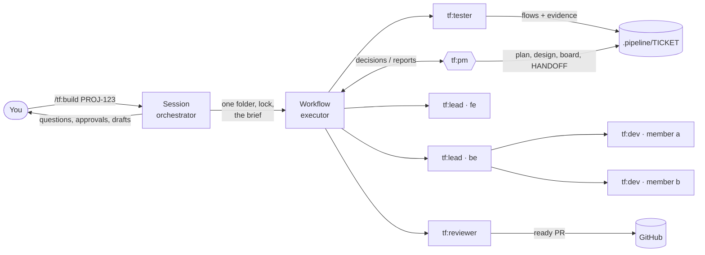
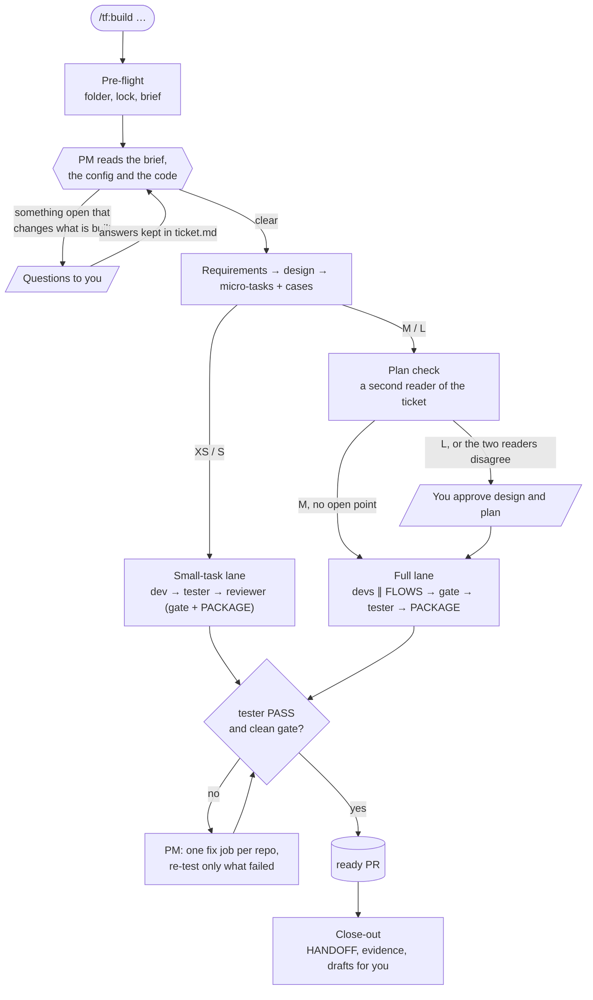

<div align="center">

# tf — task-flow

**A PM-led agent team for Claude Code: plan the task, build it, test it end to end, ship a ready PR — from a ticket, any link, or plain words. Plus clickable client demos straight from a design canvas.**

[](CHANGELOG.md)
[](LICENSE)
[](https://code.claude.com/docs/en/plugins/install.md)

`/tf:build` · `/tf:qc` · `/tf:address-review` · `/tf:review` · `/tf:e2e` · `/tf:demo` · `/tf:digest`

</div>

---

## Why tf

Running a ticket through one long agent session is slow and hard to trust: the same agent writes and judges
the code, tests are re-driven by hand every round, and a QC report three days later means re-reading
everything. **tf** organises the work like a small team:

- **A PM agent decides.** It reads the brief, the config and the code, writes the requirements and a micro-task
  plan, sizes the task, and chooses which agents run, in what order, on which model. Small tasks run three
  jobs; big ones get a written design, parallel devs per repo and a stricter review.
- **It asks before it builds — and only when it has to.** A task with two plausible readings stops with the
  questions before anything runs; a clear one runs straight through. A large task shows you its design first.
- **Hard rules live in code, not prompts.** No PR before the tester passes the latest code. No PR before a
  review gate. Writer ≠ judge. PRs are always ready. Caps stop loops that do not converge, and a job that
  cannot finish twice stops the run instead of being sent again.
- **It checks what human reviewers check.** The repo's existing tests are run, other users of changed shared
  code get a regression case, limits and modes get their own cases, and a visual fix must show a visible change.
- **E2E flows are kept.** Every case becomes a re-runnable script. A QC round re-runs the flows in minutes
  instead of clicking through the UI again.
- **One card per ticket.** `HANDOFF.md` (≤ 80 lines) is all a later round needs to start, even days later.
- **One folder per ticket.** `.pipeline/<TICKET>/` and `.worktrees/<TICKET>/<repo>/` are reused across
  every mode and round — no `-e2e`, `-fix`, `-r2` copies.

## Contents

- [Quick start](#quick-start)
- [Commands](#commands)
- [Attaching artifacts and design systems](#attaching-artifacts-and-design-systems)
- [How it works](#how-it-works)
- [Workspace configuration](#workspace-configuration)
- [Files tf creates](#files-tf-creates)
- [E2E flows](#e2e-flows)
- [Requirements](#requirements)
- [Troubleshooting](#troubleshooting)
- [FAQ](#faq)

## Quick start

```
/plugin marketplace add sdc-ren/sdc-claude
/plugin install tf@sdc
```

Then, in your workspace (the folder that holds your repos):

```
/tf:status --doctor   # checks tools, gh login, config, repos, Playwright, devices
/tf:build PROJ-123    # first run offers to create .claude/task-flow.md if it is missing
```

## Commands

Nine commands. Everything after the input is optional.

**What you can give a task command** — any of these, alone or together:

| Input | Example | tf reads it with |
|---|---|---|
| Plain words | `/tf:build thêm nút xuất Excel cho trang đơn hàng` | nothing to read: your words are the brief; the PM plans from them, the config and the code, and lists what it assumed |
| Issue key | `PROJ-123` | the tracker in your config (`## Sources`) |
| Tracker link | Jira, Linear, YouTrack, GitHub issue | the tracker line in the config, or `gh` for GitHub |
| PR link | `https://github.com/org/repo/pull/12`, `org/repo#12` | `gh` |
| Doc or web page | Notion, Google Docs, Confluence, any URL | a connector when you have one, else a public fetch or tf's own browser for sign-in pages |
| Design | Figma link; claude.ai artifact, **canvas** or **design system** | Figma connector; the Artifact tool (a canvas keeps every screen's real markup) |
| Local file | `./docs/spec.md` | read directly |

The first issue key or tracker link names the task folder; without one the folder is named after your words
(`.pipeline/them-nut-xuat-excel-trang/`), or after the first link. `--name` on `/tf:demo` (or a later round
with the same words) reuses it. Only a tracker source gets a ticket-comment draft — there is nowhere else to
post one.

| Command | Use it to |
|---|---|
| [`/tf:build`](#tfbuild) | Do a new task end to end |
| [`/tf:qc`](#tfqc) | Answer a QC report on a task tf already did |
| [`/tf:address-review`](#tfaddress-review) | Check and answer the team's review on the PRs tf pushed |
| [`/tf:review`](#tfreview) | Review a teammate's PR by reading the code (static, no e2e, no code changes) |
| [`/tf:e2e`](#tfe2e) | Run e2e only, or the regression suite |
| [`/tf:demo`](#tfdemo) | Turn a design canvas into a clickable demo for a client — no repo, no PR |
| [`/tf:digest`](#tfdigest) | Read your Zalo group chats for a day (or since last time) and get what was decided, what is open, what needs you |
| [`/tf:status`](#tfstatus) | See what tasks hold; check the machine |
| [`/tf:clean`](#tfclean) | Free finished tasks, migrate old layouts |

### Options shared by the task commands

| Option | Works with | Effect |
|---|---|---|
| `--attach` | build · qc · review · e2e · demo | Before the PM starts, show a checkbox list of this workspace's artifacts and design systems; ticked items are read into `specs/` and used by the PM, devs and testers |
| `--lang <code>` | build · qc · feedback · review · e2e | Report language for this run (`vi`, `en`, …); overrides the workspace config |
| `--approve` | build · qc | Stop after the PM writes the plan and wait for your approval (a size L task stops there anyway). You see a short summary written for you — goal, requirements in plain words, one line per repo, what is left out, risks — not the developer's task list |
| `--assume` | build · qc · review · e2e | Run unattended: no questions about an unclear task and no design approval on a size L task — the PM assumes and lists what it assumed |
| `--check` | feedback | Only fetch and triage the review points — no code, nothing posted |
| `--draft` | build · qc | Allow a draft PR. Without it every PR is opened ready, and agents never choose draft |
| pasted `https://claude.ai/artifact/…` | build · qc · review · e2e · demo | Attach that artifact directly (same as ticking it) |

You can also pick artifacts with the **Artifacts (n)** band above the chat input before sending the command
(see [Attaching artifacts](#attaching-artifacts-and-design-systems)).

### `/tf:build`

```
/tf:build <key | link(s) | words> [--attach] [--approve] [--assume] [--draft] [--lang <code>]
```

New task end to end: the PM reads the brief (your words plus every source you pointed at), asks you what it
cannot settle from the brief and the code, writes requirements and micro-tasks, staffs devs / tester / reviewer,
and closes with a **ready PR per changed repo**, e2e evidence, and a ticket-comment draft when a tracker issue
was the source.

```
/tf:build PROJ-123
/tf:build PROJ-123 --attach --approve
/tf:build "Add an export button to the orders page" --lang en
/tf:build làm màn đặt lịch theo https://www.notion.so/acme/Booking-spec-1a2b
/tf:build dựng app kỹ thuật theo canvas https://claude.ai/artifact/J1vh43YkirYZdRj5r1sZFu
```

With a canvas attached, devs build each screen from its real markup (layout, styles, copy, states) in the
repo's own stack, and testers compare every screen against the canvas's clickable export.

### `/tf:qc`

```
/tf:qc <ticket> [--attach] [--approve] [--assume] [--draft] [--lang <code>]
```

Next round of a ticket tf already did: re-reads the ticket (new or edited QC comments), reproduces the
reported cases with the saved flows, fixes only those, re-tests, and pushes to the same PR (or opens a new
one if the old PR was merged). Ends with a QC-reply draft. Attachments from earlier rounds are reused. The
round is sized by what it changes: a one-class fix on a large ticket is a small task.
Review comments from teammates on the PRs go through `/tf:address-review`.

```
/tf:qc PROJ-123
```

### `/tf:address-review`

```
/tf:address-review <ticket | PR url> [--check] [--lang <code>]
```

After a teammate reviewed a PR tf pushed. Fetches every **unresolved** review thread (ids `R1`, `R2`… stable
across runs), the reviews and the conversation comments of the task's open PRs — no Jira re-read. The PM
triages each point (a long review comment is split into points):

| Verdict | Meaning |
|---|---|
| `fix` | Fixed on the same PR branch: dev → tester (only the flows the fix touches; none for naming/comments/types) → reviewer gate and push |
| `discuss` | We disagree — with a concrete reason (ticket, decision, workspace rule, code) |
| `answered` | A question; reply only |
| `out-of-scope` | Belongs to another ticket |

Ends with `feedback-triage.md` and one answer per PR for the whole round (`feedback-replies.md`): each thread
is answered in place, every review and conversation comment in one summary with a section per reviewer, and
both are sent as a single review — one notification, not a chain of comments. When reviewers who were asked
have not reviewed yet, the run asks whether to wait for them. Nothing is posted until you approve the text;
fixed threads are resolved, discussed ones stay open for the reviewer.

```
/tf:address-review PROJ-123 --check     # what did the team say? triage only
/tf:address-review PROJ-123             # fix, push, draft replies
/tf:address-review https://github.com/org/api/pull/665
```

### `/tf:review`

```
/tf:review <PR url | ticket> [--attach] [--lang <code>]
```

Review someone else's PR by reading the code — nothing is run on the app, so it is quick:

- **Logic** — does it do what the ticket asks, branch by branch; each acceptance criterion covered / missing / partial.
- **Impact on other parts** — every function, variable, type, config key, API contract or schema the PR defines
  or changes, and who else uses it.
- **Security** — the OWASP Top 10:2025, row by row, for what the diff touches.
- **Standards** — the repo's conventions and the workspace review lessons.
- **Typecheck/build** — the only commands that run.

Ends with `review.md` and a PR-comment draft — nothing is posted until you approve the text; then it goes out
as one review, each finding as an inline comment on its line (never an approve or a request for changes). The report says
`Not run on the app` and names what is worth an e2e; run [`/tf:e2e`](#tfe2e) on the PR when the author asks for it.

```
/tf:review https://github.com/org/web/pull/720
/tf:review PROJ-123 --attach
```

### `/tf:e2e`

```
/tf:e2e <PR url | ticket> [--cases <ids>] [--target local | dev] [--assume] [--attach] [--lang <code>]
/tf:e2e --regression [--target local | dev]
```

E2E only, no code changes. You approve the test cases before anything runs:

1. The PM reads the ticket, its acceptance criteria and screens, the previous round's plan and the PR, and
   writes `.pipeline/<TICKET>/cases.md`: one section per test case (platform, screen, data, steps, expected),
   which acceptance criterion each covers, ⚠ on guesses and vague expectations, open questions and missing
   specs. A QC test-case list, when the ticket has one, is the main source and keeps QC's ids.
2. The run stops there and shows the cases as one table — ID · situation · expected result · platform · ⚠ —
   with the counts and the questions. You answer, attach missing specs, edit `cases.md` and approve.
3. Exactly the approved cases run. Saved flows that still match a case re-run without any agent; the tester
   writes or fixes only the rest. A later `/tf:e2e` with nothing changed re-runs in minutes with no model.
4. Each failed case has a screenshot that points at the bug (red box, red label, close-up), and the ticket
   comment draft follows the QC layout (summary table, then Vấn đề · Hiện tại · Mong muốn · Evidence).

| Option | Effect |
|---|---|
| `--cases TC1,TC2` | Only these approved cases |
| `--target local\|dev` | Where the cases run: the task's local ports or the shared dev environment from the config |
| `--assume` | Approve the PM's cases without stopping (unattended runs) |
| `--regression` | Instead of a ticket, run `.pipeline/_regression/` — the passing flows of merged tickets |

```
/tf:e2e PROJ-123 --cases TC1,TC2
/tf:e2e https://github.com/org/app/pull/213
/tf:e2e --regression --target dev
```

### `/tf:demo`

```
/tf:demo <canvas link> [what to show] [--publish] [--feedback <email | form link>] [--comments] [--name <name>] [--lang <code>] [--attach]
```

A Claude **Design canvas** → a clickable demo for a client. Every screen of the canvas becomes a page that runs
the screen's own code: buttons, tabs, toggles, form fields and the links between screens work as in the
canvas's Play mode. No repo, no worktree, no PR, no agents — it takes a minute.

- **Grouped by role.** The canvas's biggest title notes (e.g. *Kỹ thuật · App*, *Văn phòng · Web*) become
  groups, smaller ones sections. The index has one card per role with a **Start** button, and each role has its
  own link (`…/#ky-thuat`) to send to the people who use that role. Screens shared between roles and the links
  between them keep working, because it is one demo.
- **Phone and web.** Frames up to 500 px wide show in a phone frame on a computer and full screen on a phone;
  web pages (`expand: fill`) fill the window.
- **Checked before you see it.** Every screen is rendered once in Node with each handler pressed; a screen
  whose code throws, a link to a screen that is not on the canvas, or a missing asset is reported.
- **Where it runs.** Locally (`http://localhost:4173`) by default. `--publish` also publishes it as **one
  private artifact** you can share; a later run updates the same artifact.
- **Feedback on each screen.** Every screen has a Feedback button. In the published artifact it opens claude.ai's
  comment box pinned to that screen; share the artifact by email at **Commenter** and the client signs in to
  claude.ai with that email to comment. People who cannot comment (not signed in, a public link, the local demo)
  are sent to `--feedback` instead: an email with the screen in the subject, or a form link with `{screen}` filled
  in. `/tf:demo <canvas link> --comments` collects the comments into `demo-feedback.md`, grouped by role and screen.

```
/tf:demo https://claude.ai/artifact/J1vh43YkirYZdRj5r1sZFu
/tf:demo https://claude.ai/artifact/J1vh43YkirYZdRj5r1sZFu cho khách xem role kỹ thuật và khách hàng --publish --feedback pm@acme.vn
/tf:demo https://claude.ai/artifact/J1vh43YkirYZdRj5r1sZFu --comments
```

It is the canvas's screens with their sample data — no backend, nothing saved. Only words and a design system,
no canvas yet? tf offers to draw the screens on a new canvas first. To build the real app from the same canvas:
`/tf:build <description> <canvas link>`.

### `/tf:digest`

```
/tf:digest <chat name(s) | all> [hôm nay | hôm qua | YYYY-MM-DD | DD/MM | A..B | 6h | since-last] [--photos N] [--focus "…"] [--lang <code>]
```

Too many project groups to read all day? `/tf:digest` reads the ones you name in **Zalo Web** — your own account,
in your own Chrome (Claude in Chrome) — and writes a digest per chat: **Cần bạn** (questions and mentions waiting
on you), **Đã chốt**, **Đang bàn**, **Việc cần làm**, ideas for later. Every point carries its time and sender so
you can find it in Zalo.

- **Exact window.** Zalo Web keeps each message's time, sender and type in the browser, so tf counts the window
  first (`306 messages, 07:08–18:28`) and then reads exactly those — no guessing where "yesterday" starts. The
  digest says how many were read of how many; anything not read is listed, never dropped.
- **Noise out.** Stickers and system notices are skipped. Photos sent together are one line; the photos people
  replied to or talked about are opened and read (`--photos`, default 6), the rest stay `[ảnh]`.
- **Since last time.** With no time given it reads from where the last digest of that chat stopped
  (`.pipeline/digest/state.json`).
- **What it does not do.** It never logs in for you, never sends, reacts or types in a chat, never calls Zalo's
  servers or decrypts anything: it reads what the page shows you. Opening a chat marks it read, as when you open
  it. Zalo Web runs in one tab: if yours is open, tf takes over in its own tab and yours asks you to press
  *Kích hoạt* to use it again. The messages are read into this Claude session; only the digest file is written.
- **Your chats in the config** (optional): `## Chat sources` in `.claude/task-flow.md`,
  `- NhatLinh: zalo g1705741417791397411 — 8fix app; client feedback on the demo`, then `/tf:digest all hôm nay`.

```
/tf:digest NhatLinh hôm nay
/tf:digest NhatLinh hôm qua --focus "thanh toán"
/tf:digest all
```

### `/tf:status`

```
/tf:status [--doctor] [--metrics [slug]]
```

One table, one row per task: its PRs (how many merged), what it holds (worktrees, databases, cache dbs,
ports), the disk its worktrees take, and whether `/tf:clean` frees it now — then the totals, and a ⚠ line when two
tasks hold the same id.

| Option | Effect |
|---|---|
| `--doctor` | Also check this machine and workspace: Node, git, `gh` login, plugin agents and guidelines, workspace config, repos and their base branches, Playwright, and the config's own `## Doctor` checks (DB containers, SDKs, devices…) — with how to fix each failure. Run it once on a new machine. |
| `--metrics [slug]` | What runs cost, measured from the agents' transcripts: one line per run (plugin version, wall time, minutes per role, jobs, re-tests, tokens). With a slug: every job of that task — minutes, time in tools vs model, slowest commands. Each run is also saved to `.pipeline/<TICKET>/metrics.json` and summarised in the run report. |

### `/tf:clean`

```
/tf:clean <slug>
/tf:clean --migrate
/tf:clean --legacy
/tf:clean
```

Every form shows a **dry run first** and changes nothing until you say yes.

| Form | Effect |
|---|---|
| `<slug>` | Free one task's resources (worktrees, DB, cache, ports) and archive its folder. Worktrees with uncommitted or unpushed work are kept |
| `--migrate` | Move old flat worktrees (`.worktrees/proj-123-fe`) into `.worktrees/PROJ-123/frontend/` and update the ledgers |
| `--legacy` | Fold old suffixed task folders (`PROJ-123-e2e`, `-qc`, `-r2`…) into `.pipeline/PROJ-123/history/legacy/` |
| *(nothing)* | Clean the workspace: free and archive every task whose PRs are all merged or closed (and idle ones past `TF_PRUNE_DAYS`), promote their passing flows to `_regression/`. Also says what `--migrate` and `--legacy` would do |

An archived task keeps its text (plans, ticket, handoff, feedback, history) and drops evidence images, logs,
scratch and attachments — the PRs are merged by then. Nothing is cleaned in the background: when the last
`/tf:clean` is over a week old and worktrees or the archive have piled up, the run report ends with one line
saying so.

Nothing is ever posted to the tracker or GitHub as a comment without your approval of the exact text. On Jira,
tf reads and posts with `scripts/jira.mjs` (through your signed-in browser session); agents cannot post.
tf never merges, approves, force-pushes, or enables auto-merge.

## Attaching artifacts and design systems

Claude artifacts, canvases and design systems belong to your account, not to a folder; tf shows only the ones
that belong to the **current workspace** — created in its Claude Code sessions, attached to its earlier tasks,
or pinned in its config. No setup, and other projects' items never appear.

| Way | Where | How |
|---|---|---|
| **Artifacts (n)** band | Above the chat input (desktop app and terminal) | Open it, press items (grouped *Design system*, *Artifacts*, *Canvases*); picked ones show ✓ and are appended to your next message, e.g. `/tf:build PROJ-123` |
| `--attach` | Any task command | A checkbox question before the PM starts |
| Pasted link | Any task command | `https://claude.ai/artifact/…` in the command; use it for artifacts made in the claude.ai web app |
| `@` mention | Terminal CLI only | The plugin's `artifacts` MCP server lists them in `@` autocomplete |

Attached items are saved to `.pipeline/<TICKET>/specs/` and `attachments.json`: the PM plans from them, devs
use the design system's tokens and components, testers check the UI against it, and later rounds reuse them.
A **canvas** is kept whole: every screen's `.dc.html` source, a summary (roles, screens, devices, which screen
links where, the canvas's notes) and a clickable export testers compare against. Any other link or file can be
attached the same way — pass it with the command.
The band appears once the session has started (after your first message in a new session). It shows
`Artifacts (0)` when the workspace has none yet; open it for how items get there.

## How it works

**Who talks to whom**



**What one run goes through**



1. **Pre-flight (your session).** `task.mjs resolve` maps the input (ticket key, PR URL, or text) to exactly one
   folder, finds existing worktrees and PRs, and takes a lock. The brief — your words and every source, verbatim
   — is saved as `ticket.md`; on later rounds new or edited comments are marked. The workflow is listed under
   the task's id in `/workflows`.
2. **Understand first.** `tf:pm` reads `HANDOFF.md` / the brief, the config and every repo it lists. Whatever
   is still open is sorted: a point with two plausible readings that would build different things, and that
   nothing it read settles, is a **question for you** — the run stops before any plan, you answer in a picker
   (product decisions can go to the PO as a drafted tracker comment), the answers are kept in `ticket.md` and
   the run starts again. Everything else is an assumption it lists. A clear task is not asked about.
3. **Requirements → design → tasks.** The plan starts with numbered requirements a flow can check, each with
   the words of the brief it comes from. An M task adds a short design (data and what happens when it changes
   later, neighbouring features, interfaces, decisions); an L task writes `design.md` before the plan. Then
   micro-tasks (what + exact file, *how* only at contracts), cases with their data and expected result, and
   coverage `R<n> → micro-tasks → cases`.
4. **Check the plan (M/L).** A second agent reads the ticket and the plan with none of the PM's reasoning. Its
   points go back to the PM once; if the two still disagree, you decide. An L task always shows you its design
   and plan before the first job.
5. **Jobs.** The executor runs the dispatch, groups in order, jobs of one group in parallel:
   - *small-task lane (XS/S)* — the dev job → the tester with only the cases the change touches → one reviewer
     job that runs the gate checklist and, when it is clean, commits, pushes and opens the PR;
   - *full lane (M/L)* — one `tf:lead` per repo in parallel (alone, or with up to 3 `tf:dev` members on
     separate files) plus a `tf:tester` `FLOWS` job writing the flows from the plan → a `tf:reviewer` gate per
     repo → `tf:tester` → a `PACKAGE` reviewer job.

   App servers start once per run (`serve.mjs`) and stay up across jobs.
6. **Repeat** until the PM closes. A job that did not finish, a gate that asks for changes or a tester that did
   not pass skips the later groups and the PM re-plans: one fix job per repo with the open issue ids, then only
   the failing flows are re-run.
7. **Close-out (your session).** Evidence is uploaded per the workspace config, drafts are shown to you,
   `HANDOFF.md` is rewritten for the next round, and the run's cost is measured (`/tf:status --metrics`).

### What the gate and the tester look for

Beyond scope, contract, conventions and tamper, the checks that human reviewers kept catching are built in:

| Check | Who | What happens |
|---|---|---|
| Existing tests | dev lead, gate | The repo's own suite (config `## Checks`) is run; each failure is either caused by the change — fixed, or the gate rates it P2 — or shown to fail on the base as well. "No new unit tests" never means "do not run the old ones" |
| Impact | gate → tester | Other users of every shared function, helper, component or query the diff changes are listed; one that no case covers becomes an `IMPACT` case the tester of that dispatch runs |
| Limits and modes | PM, plan check | A rule with a limit gets a case at the limit and just past it; a flag one side accepts and the other rejects in some mode gets a case per mode |
| Visual fixes | tester | Before and after shots of the region the ticket names must differ, and the after state is asserted by measurement; identical shots are never a PASS |
| Design | gate | On M/L the diff must do what the design decided; a departure nobody explained is P2 |
| Roles and lifecycle | PM, plan check | Every role that opens the changed screen gets a case; a value changed after it was locked, a feature turned off then on, and rows written before the change get "go back" cases |
| Security | dev, gate, review mode | `scripts/security-scan.mjs` runs first on every change: secrets and sensitive values in log calls on the added lines, new or re-versioned dependencies (each must exist under that exact name), and `gitleaks`, `semgrep` (recommended ruleset, OWASP rules included) and `npm audit` when installed — a scanner that is missing is reported as not run, never as a pass. Then the gate reads the diff against S1–S7 of [guidelines/review-standard.md](guidelines/review-standard.md) (access control, audit trail, logs, input, secrets, dependencies, data integrity). A change in auth, permissions, locks, money, audit or migrations is gated on opus (its dev keeps its own model) and gets a `## Security` section in the PR. With `--out` the scan prints a few-line summary and keeps the full JSON in the file, so an agent's context holds only the summary |
| Self-check | dev lead → gate | The dev report fills the miss-category table of [guidelines/review-standard.md](guidelines/review-standard.md) — client parity (error keys, limits, nullable fields, enums in every client), modes, roles, lifecycle, scope against approval — with evidence; a category the diff touches with no row, or evidence that does not hold, is P2 |

### Hard rules

The executor enforces these in code; an agent cannot talk its way past them. The full list, with the reason
for each, is in [docs/design.md](docs/design.md#hard-rules).

| Rule | Why |
|---|---|
| No PR until a tester passed the latest code of that repo, and the PR comes from a job started after that pass. A tester that did not pass skips everything after it in the dispatch | Nothing ships untested |
| Writer ≠ judge: dev, tester and reviewer are separate agents; the gate runs on the dev lead's model | No one marks their own work |
| M/L: no `PACKAGE` without a gate that passed after the repo's last dev job, and the gate runs before the tester. XS/S may fold the gate into the `PACKAGE` job; a small-lane change that grew past 3 files gets a separate gate first | No test run thrown away by a gate on large changes; small ones do not pay for the full pipeline |
| Dev jobs never commit, push or merge; a team member never edits another member's file | The reviewer packages; parallel coding without collisions |
| Questions only before the first job, at most 3 rounds, never with `--assume` | An unclear task waits for you; a run in progress is not interrupted for a detail |
| M/L: a second agent reads the ticket and the plan before any job runs; if it and the PM still disagree, you are asked. L: you see the design and the plan first | A wrong plan is caught before it costs a run |
| XS/S: the tester runs only the cases the change touches. XS: one repo, no `FLOWS` job, no dev team. No `FLOWS` job in a fix round | A one-line fix does not pay for the whole saved suite |
| The same kind of job on a repo unfinished twice in a row → the run stops with both reasons | A permission or environment block is yours to fix; a third try changes nothing |
| PRs are ready (draft only with `--draft`); limits on turns, jobs and fix attempts | A PR means "done and verified"; loops that do not converge escalate to you |
| Commits and PR titles are `<type>(<KEY>): …` with the issue key as the scope, and a PR title is English — a wrong `git commit -m` or `--title` is refused at the tool call ([guidelines/git.md](guidelines/git.md)) | One naming style in every repo, whatever the history looks like |
| A cache index, port, DB or emulator is held by one task at a time | Two tasks never write the same cache or database |

### When tf stops for you

| When | What you get | Skip it with |
|---|---|---|
| Before anything runs, the brief leaves open something that changes what gets built | The questions, each with the unclear words quoted, the options and the PM's own pick | `--assume` |
| A size L task has its design and plan | A summary of `design.md` and the plan; a change you ask for sends the PM back to the design | `--assume` |
| You passed `--approve` | The plan, before any job | — |
| The plan check and the PM read the ticket differently | Both readings, side by side | — |
| Mid-run: broken layout or UI clearly unlike the design; a flow or spec change the ticket does not settle; risk to money, permissions, data or security; an edit needed inside a read-only zone; a blocker no job can remove — plus whatever your config adds | One question with its options | — |
| The same job could not finish twice | Both reasons, and whether it looks like a tool-permission block | — |

Everything else is decided and listed as *assumptions* in the round report so you can correct it.

### Sizing

The PM sizes by the change, not by the ticket's wording, and a later round by what that round changes.

| Size | Typical task | Documents | Lane | Agents |
|---|---|---|---|---|
| XS | text, colour, spacing, show/hide; one repo, 1–3 files | requirements (1–5 lines) | small-task | PM · dev · tester · reviewer |
| S | a field or column, one screen, one endpoint | requirements | small-task when ≤ 3 files per repo, else full | + `FLOWS` when 3+ new flows |
| M | 2+ repos meet, or an API/contract change | requirements + `## Design` in the plan | full, plan check | one lead per repo, gates, testers |
| L | new feature, migration, money, permissions | requirements + `design.md`, approved by you | full, plan check | as M, opus where risky |

Money, auth, permissions, data migrations and read-only zones never go below M. Details:
[docs/design.md](docs/design.md#sizing-and-models-pm-decides).

## Other coding agents

tf's code and prompts are shared; what one coding agent does its own way lives in `hosts/<agent>/` (its build,
its notes, how it runs a job). The docs write those steps as *(host: …)*.

| | Claude Code | Codex | GitHub Copilot CLI (not tried yet) |
|---|---|---|---|
| Install | `/plugin install tf@sdc` | `codex plugin add tf@sdc` (same marketplace) | `copilot plugin install tf@sdc` (same marketplace) |
| Call a command | `/tf:build …` | `$tf:build …` | the name `/skills list` shows |
| Executor | the Workflow tool, jobs as subagents | `hosts/codex/run.mjs` in the background, each job a `codex exec` | `hosts/copilot/run.mjs` in the background, each job a `copilot -p` |
| Asking you | `AskUserQuestion` | questions in the reply; the run waits for your answer | the same as Codex |
| Tool guard | hooks module (`hooks/guard.ts`) | `PreToolUse` command hook (`hooks.json`), active only in tf's jobs | the same hook file, if Copilot reads it |
| Models | haiku / sonnet / opus per job | your Codex model; the tier sets the reasoning effort (low / medium / high) | Copilot's default, or `TF_COPILOT_MODELS` per tier |
| `/tf:demo`, `/tf:digest`, attachments, metrics | yes | no | no |

Codex jobs run in Codex's workspace-write sandbox with network on, tf's state folder and the workspace repos'
`.git` folders writable, and approvals routed to Codex's automatic reviewer (`--approve-for-me`). Extra flags
for every job: `TF_CODEX_ARGS='["-m","<model>"]'`; jobs at once: `TF_JOBS` (default 4).

Copilot jobs run with `--no-ask-user`, git, node, the package managers and `gh` allowed, and everything else
sent to Copilot's safety review (`--assisted-approval`). `TF_COPILOT_MODELS='{"large":"<model>"}'` picks
models per tier, `TF_COPILOT_ARGS` adds flags. A prompt is passed on the command line: on Windows a very long
job prompt may not fit.

## Workspace configuration

tf reads `<workspace>/.claude/task-flow.md`. Start from [docs/config-template.md](docs/config-template.md).

```md
## Language
- Report language: `vi`        # what tf tells you, .pipeline files
- Writing language: `vi`       # commits, PR bodies, reviews, ticket comments (PR titles stay English)

## Repos (the PM inspects every one and picks what the task touches)
| key | path | base branch | package manager | lockfile → reusable dirs | conventions to read |
|---|---|---|---|---|---|
| be | `backend/`  | `develop` | npm  | `package-lock.json` → `node_modules` | `backend/CLAUDE.md` |
| fe | `frontend/` | `develop` | pnpm | `pnpm-lock.yaml` → `node_modules`    | `frontend/CLAUDE.md` |

## Excluded (never inspected, never changed)
- `autotest/`

## Read-only zones (read and call, never edit — an edit needed here → the PM asks you)
- `payments-core/`, `backend/src/blockchain/**`

## Test policy
- e2e-only — no new unit/DB tests; cover reviewer-expected tests with e2e/API flows and say so in the PR.

## Checks (existing tests — run by the dev lead, checked by the gate; never new tests)
| repo | command | notes |
|---|---|---|
| be | `npx jest test/unit/services` | 2 suites already red on develop |
| fe | `npm test` | |

## Flows (e2e)
- Playwright package: `<root>/autotest/package.json`
- Targets: `local` = the task's ports; `dev` = https://dev.example.com
- Web viewport: 1440x900. Android: AVD `my_avd`. iOS: out of scope.

## Provisioning · Doctor · Hard rules · Close-out
…
```

Other sections: sources (how to read hosts that need it — trackers, docs; any link works without a line), knowledge files (known bugs, env recipes, decisions,
**review lessons** — rules learned from human reviews that devs and reviewers check before every job),
provisioning recipes (worktree, DB, cache, ports), doctor checks, and close-out (where evidence goes, how
approved comments are posted).

## Files tf creates

```
<workspace>/
  .pipeline/PROJ-123/
    ticket.md          the brief: your words and every source verbatim, plus your answers (## Clarifications)
    HANDOFF.md         ≤ 80-line card — the first thing every later round reads
    plan.md            current round: requirements, design (M), micro-tasks, contract, cases, coverage
    design.md          size L only: data, neighbours, interfaces, decisions, flow, risks — kept across rounds
    board.md           the PM's ledger: jobs, results, assumptions, open issues
    journal.md         append-only log, 1–3 lines per job
    jobs/J<n>-<role>-<repo>.md   each job's brief and report
    flows/*.mjs, flows.json      re-runnable e2e cases
    evd/               WebP screenshots, verdicts
    specs/             attached artifacts, canvases, design systems
    history/r<N>/      earlier rounds
    resources.json     everything the task holds, with the command that frees it
    metrics.json       measured cost of every run
    PROJ-123.js        this run's copy of the engine, named after the task (rewritten every run)
  .worktrees/PROJ-123/
    backend/  frontend/  mobile/     one git worktree per repo the task touches
  .pipeline/_lib/                    flow helpers shared by every task (login, seeding)
  .pipeline/_regression/             passing flows of merged tickets
```

`~/.claude/task-flow/` keeps machine-level state: saved tracker logins (`auth/`) and the cleanup log.

**Cleanup.** A task run never cleans up after other tasks. `/tf:clean` frees a task's resources once all its
PRs are merged or closed and promotes its passing flows to `_regression/`; idle tasks are freed after
`TF_PRUNE_DAYS` (7). Nothing cleans up in the background: it happens only when you run `/tf:clean`. A job
installed by a version before 1.16.0 is removed with `node <plugin>/scripts/reaper.mjs uninstall`. Worktrees with uncommitted or unpushed work are never removed. The full
schedule is in [docs/design.md](docs/design.md#retention).

## E2E flows

One file per case, re-run instead of re-driven. Standard: [guidelines/e2e-testing.md](guidelines/e2e-testing.md).

```js
// .pipeline/PROJ-123/flows/21.mjs
const { webFlow } = await import(process.env.FLOW_KIT)
await webFlow('21', async ({ page, step, shot, gotoReady, expect, uniq }) => {
  await step('open import', () => gotoReady('/organizer/import', 'text=Athlete code', '/api/imports'))
  await shot('after')
  expect(await page.getByText('Athlete code').isVisible(), 'column visible')
})
```

```bash
node <plugin>/scripts/flow-run.mjs .pipeline/PROJ-123 --target local          # all cases
node <plugin>/scripts/flow-run.mjs .pipeline/PROJ-123 --failed                # only what failed last time
node <plugin>/scripts/flow-run.mjs .pipeline/PROJ-123 --cases TC1 --target dev # reproduce a QC report
node <plugin>/scripts/cases.mjs status .pipeline/PROJ-123                      # approved cases: flow fresh/stale/missing, result valid?
node <plugin>/scripts/flow-run.mjs .pipeline/PROJ-123 --jobs 3                # three cases at a time
node <plugin>/scripts/flow-peek.mjs .pipeline/PROJ-123 /some/screen           # what is on a screen, with locators
node <plugin>/scripts/flow-peek.mjs .pipeline/PROJ-123 - --android emulator-5560 # what the emulator shows, as selectors
node <plugin>/scripts/flow-run.mjs .pipeline/PROJ-123 --changed               # only cases not green on this commit + flow
node <plugin>/scripts/flow-run.mjs .pipeline/PROJ-123 --list                  # one line per flow: last result, up to date or stale
node <plugin>/scripts/task.mjs config . --role tester                         # only the config sections a role needs
node <plugin>/scripts/jira.mjs read .pipeline/PROJ-123 PROJ-123 --site https://acme.atlassian.net --md ticket.md  # the issue + comments
```

- Waits for the app, not the clock: `waitApi`, `ready`, `gotoReady`; a 15 s ceiling per step, never a delay, and
  a ceiling per case (180 s Web/API, 360 s Android) — a hung case is stopped and the result names its step.
- Log in once: an Android flow wraps its login in `session(key, login, { appId, ready })` — later runs restore the
  saved app session in seconds instead of filling the form again (measured: ~80 s → ~7 s).
- A failed step leaves what was on the screen: `<case>-fail-<step>.page.txt` (Web) or `.ui.txt` (Android), with
  the locators to use, so the flow is fixed from it instead of re-run.
- Evidence: `<case>-after.webp` (+ `before` for visual changes), failure screenshot automatically,
  Playwright trace only with `TRACE=1`. `expect(cond, label, { at, expected, actual })` and `mark(at, label)` make
  the runner draw a red box and label on the element (`annotate.mjs`, Chromium; ffmpeg draws boxes only). A visual case passes only when before and after differ where the
  ticket says and the after state is measured.
- Cheapest level that proves a case: API before Web before App. Login and seeding live once in
  `.pipeline/_lib/`, not in every flow.
- A bug is reported only with proof: the data the flow used was checked, and the failing step was repeated
  once outside the flow.
- Console errors and HTTP 5xx are reported with the verdict even when the case passes.
- Android: `androidFlow` drives the task's own emulator with adb (Flutter `Semantics(identifier:)` →
  `resource-id`).

## Requirements

| Need | Notes |
|---|---|
| Claude Code with Workflows enabled | Paid plan or API; allow the Workflow tool when asked |
| Node ≥ 22 (a supported LTS line, kept patched), git, `gh` logged in | `gh auth login` + `gh auth setup-git` for private repos |
| Playwright | Any package that depends on `@playwright/test`, referenced in the config |
| Per workspace | Whatever the config's provisioning needs: Docker DBs, Android SDK + AVD, Flutter… |
| macOS, Linux or Windows | See the table below. On Windows install [Git for Windows](https://git-scm.com/download/win): tf runs its commands through Git Bash, as Claude Code does. |

### Operating systems

The scripts and the executor's rules are tested on all three in CI (`.github/workflows/tf.yml`). A whole ticket
run — servers, browser, emulator — has only been done on macOS so far; reports from Linux and Windows are welcome.

| | macOS | Linux | Windows |
|---|---|---|---|
| Shell for scripts and config recipes | `/bin/sh` | `/bin/sh` | Git Bash (required) |
| Dependency copy for a new worktree | APFS clone (instant) | reflink on btrfs/xfs, else copy | copy |
| Who owns a busy port | by the process's folder | by the process's folder | the server tf started itself |
| Tracker login | the session of your own browser (Chrome, Arc, Brave, Edge, Vivaldi), read without opening it; else log in once | log in once in the browser tf opens | log in once in the browser tf opens |
| Android emulator | yes | needs KVM | needs hardware acceleration (WHPX/AEHD) |
| Claude Code desktop app | yes | Debian-based only (beta); else the CLI | yes |

Workspace config recipes (`## Provisioning`, `## Doctor`) are yours: write them with commands that exist on the
systems your team uses. `node <plugin>/scripts/platform.mjs free-port <port>` and `… kill <pid>` work everywhere.
tf does not run inside WSL sessions of the desktop app (plugins are not loaded there); in WSL use the CLI.

Run `/tf:status --doctor` to see what is missing.

## Troubleshooting

| Symptom | Fix |
|---|---|
| `lock-conflict` / "another run holds it" | A run is active, or one crashed less than 90 min ago. Check `/workflows`; remove `.pipeline/<slug>/.lock` only when nothing runs. |
| PM escalates "rejected twice by the hard rules" | Read the rule in the message; usually a judge was put in the same group as a dev, or a PR was a draft. |
| The run ends asking you questions | The brief had two plausible readings. Answer them (or pick "PM decides"); the run starts again with the answers in `ticket.md`. `--assume` skips this. |
| The run ends asking you to approve a design | A size L task. Read the summary, approve or say what to change. `--assume` skips this. |
| "… could not finish twice in a row" | The same job was blocked twice and was not sent a third time. The message carries both reasons; when it says tool-permission block, check the session's permission mode and any hook that rewrites commands, then run the command again. |
| Tester says `blocked-env` | The environment is missing something (DB, port, emulator, login). `/tf:status --doctor`, then fix the config's provisioning. |
| Flow fails after an intended UI change | The tester marks it `flow-broken`, fixes the selector and re-runs — not an app bug. |
| Old `-e2e` / `-qc` folders or flat worktrees | `/tf:clean --legacy`, `/tf:clean --migrate`. |
| Plugin update not picked up | `claude plugin marketplace update sdc && claude plugin update tf@sdc`, then restart. |

## FAQ

**Does tf write unit tests?** Only if your workspace `Test policy` allows them. Verification is e2e flows
with evidence; typecheck, lint, build and the repo's existing tests (config `## Checks`) run as checks.

**Will it keep asking me things?** No. It asks before the first job, only about what would change the thing
being built and cannot be read from the brief or the code, at most three times; a clear task runs without a
word. Pass `--assume` to run unattended.

**Can I use it in any repository layout?** Yes — a workspace is any folder whose config lists one or more
git repos. A single-repo project lists just one.

**Where do the rules come from?** Three layers, described in [guidelines/review-standard.md](guidelines/review-standard.md):
the plugin's `guidelines/` (git, PR description, PR review and its miss categories, ticket comment, e2e) for
every project; the config's `## Team agreements` plus the repo's own conventions (CLAUDE.md, CONTRIBUTING,
commitlint), which win on conventions; and the workspace's review lessons, learned from its own reviews. Review
rounds tag each point with its category, and the close report proposes what should move up a layer.

**What does it cost?** Fewer agents than a fixed pipeline: a small task runs five (the PM twice, a dev, a
tester, a reviewer), a large one a lead per repo with gates and testers. Each job gets the model its work
needs: opus for the PM's planning turn, risky logic and turns that judge a failure; sonnet for ordinary dev,
testing, gates and PR packaging; haiku for setup and tiny edits, retried once on sonnet if it cannot finish.
`/tf:status --metrics` shows what each run really cost.

## More

[docs/design.md](docs/design.md) — roles, hard rules, files, retention, metrics.
[docs/orchestrator.md](docs/orchestrator.md) — what a `/tf:*` command does step by step.
[docs/orchestrator-e2e.md](docs/orchestrator-e2e.md) and [docs/pm-e2e.md](docs/pm-e2e.md) — the e2e parts, read only by e2e runs.
[docs/reviewer-plan.md](docs/reviewer-plan.md) and [docs/reviewer-review.md](docs/reviewer-review.md) — the reviewer's plan check and
review mode, read only by those jobs.
[CHANGELOG.md](CHANGELOG.md) — what changed in each version.

## License

[MIT](LICENSE) © 2026 SDC (Dang Chi Son)
